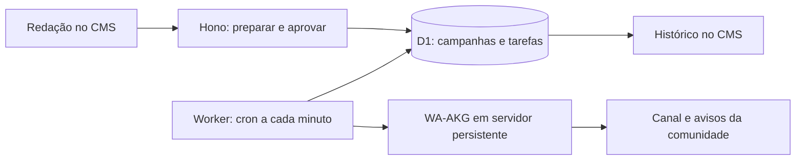

# TRD — Integração do Diário do Povo com WA-AKG

> **Direção atualizada:** a prioridade passou a ser a jornada do leitor para o canal existente: landing em `/whatsapp` e chamada nas matérias, sem gateway nem publicação automática. O plano de integração abaixo fica como referência de uma evolução futura, fora da implementação atual.

| Campo | Valor |
| --- | --- |
| Versão | 1.1 — prioridade: canais e comunidades |
| Data | 4 de novembro de 2026 — America/Fortaleza |
| Status | Proposta técnica para revisão; implementação e operação ainda não iniciadas |
| Produto | Distribuição editorial de notícias pelo WhatsApp |
| Escopo inicial | Piloto com um número administrador, um canal e uma comunidade de teste |
| Responsáveis | Produto/editorial: direção do jornal; implementação: engenharia; operação: responsável pela infraestrutura, a designar |

## 1. Objetivo e decisão proposta

Permitir que a redação prepare, aprove e envie título, resumo e link de uma matéria publicada para canais e destinos editoriais de comunidades pelo CMS. O WA-AKG será um serviço externo persistente, acessado exclusivamente pelo backend. O portal mantém aprovação, fila, auditoria e controle de envio; o gateway mantém a conexão com o WhatsApp.

Adicionar WA-AKG como provedor explícito, preservando a integração existente com a Cloud API da Meta. Uma campanha usará um único provedor, fixado no momento da aprovação. Não haverá fallback automático entre provedores.

Critério de sucesso do piloto: dez publicações de teste em canal e dez no grupo de avisos de uma comunidade, ao longo de pelo menos sete dias, sem duplicações observadas e com rastreabilidade de todas as tentativas, além da aprovação dos testes de falha descritos neste documento. Esse resultado não constitui garantia de escala ou disponibilidade futura.

## 2. Base técnica verificada

### Portal

- Hono e TypeScript sobre Cloudflare Pages/Functions, D1, KV e R2; build Vite e testes Vitest (`package.json`).
- Módulo existente em `packages/core/whatsapp/{types,repository,service}.ts`, com leads, consentimento, contatos, destinos, campanhas e entregas.
- `service.ts` envia atualmente pela Cloud API da Meta e processa o formato de webhook da Meta; não aceita diretamente o formato WA-AKG.
- Administração em `packages/core/admin/whatsapp.ts`, configurações em `packages/core/admin/integrations.ts` e rotas em `functions/index.ts`.
- Landing e descadastramento em `packages/core/web/whatsapp.ts`; estrutura inicial em `migrations/0041_whatsapp_audience.sql`.
- Publicação programada já é executada por `workers/post-scheduler.ts` e `packages/core/post-scheduling.ts`.
- A integração direta com Instagram fornece um precedente local de fila, aprovação e resultado incerto (`packages/core/instagram/direct.ts` e `docs/instagram-direct.md`). Reutilizar o padrão após revisar seu contrato; não acoplar as duas filas.

### Gateway

Repositório: https://github.com/mrifqidaffaaditya/WA-AKG, branch `main`, `package.json` com versão 1.7.0 na leitura desta análise. O commit completo da implantação deverá ser fixado na fase 0; os links de branch abaixo são mutáveis.

- Servidor Node.js próprio com Next.js, Socket.IO e Baileys; exige execução persistente.
- MySQL é o provider atualmente declarado no Prisma; a documentação também menciona PostgreSQL, mas isso não implica troca automática de provider.
- Envio por `POST /api/messages/{sessionId}/{jid}/send`, com `X-API-Key` e corpo `{ "message": { "text": "..." } }`.
- A rota verifica autenticação e acesso à sessão e responde `{ status, message, data }`; o formato do identificador de mensagem em `data` precisa ser confirmado em homologação.
- Há dois caminhos de agendamento e diferenças no uso de identificadores de sessão. O piloto não utilizará o agendamento nem o broadcast do gateway.
- Telemetria externa está habilitada por padrão. Desabilitar explicitamente no contêiner/processo e verificar a configuração efetiva.

Esta base resulta de leitura estática do código. Não foram executados gateway, testes de carga, consultas ao ambiente de produção ou envios reais. O diretório local contém mudanças anteriores; este TRD não atesta que todas estejam implantadas.

## 3. Escopo

### Prioridade do produto e prova de capacidade

Canais e comunidades são o objetivo principal desta integração. Um envio bem-sucedido para um grupo comum não comprova o atendimento ao requisito. A decisão de adotar o WA-AKG depende da prova de publicação nos dois destinos prioritários.

| Prioridade | Destino | Comportamento exigido |
| --- | --- | --- |
| P0 | Canal do jornal | Publicar título, resumo e link como administrador do canal; validar o JID de canal e a exibição em conta seguidora |
| P0 | Grupo de avisos da comunidade | Identificar o grupo de avisos e publicar nele com a permissão necessária; validar em conta participante |
| P1 | Grupos vinculados à comunidade | Selecionar explicitamente grupos editoriais e criar uma tarefa por grupo após homologação; sem expansão automática |

Comunidade é um agrupamento de destinos. Cadastrar seu identificador não significa que uma mensagem será enviada a todos os grupos. O destino de avisos deve ser identificado separadamente; não inferir seu JID a partir do ID da comunidade. Canal é um destino próprio, com JID `@newsletter`, e não deve ser normalizado para telefone ou `@g.us`.

Evidências estáticas adicionais verificadas em 4/11/2026:

- `ChatService.sendTextMessage` encaminha o JID recebido para `socket.sendMessage`, e o serviço reconhece `@newsletter` nos filtros. Isso indica um caminho possível de envio, mas não comprova publicação em canal real.
- O schema Group possui `isCommunity` e `linkedParentJid`; a rota `GET /api/groups/{sessionId}` retorna registros desse modelo. A presença dos campos não garante sincronização atualizada, descoberta do grupo de avisos ou permissão de publicação.
- Não foi encontrada a rota específica `/api/communities/{sessionId}` consultada. A ausência dessa rota não prova ausência de todos os recursos de comunidade; a integração não dependerá de um endpoint presumido.

A fase 0 deve comprovar, no commit fixado: (a) obtenção segura do JID do canal, mesmo que por cadastro manual validado; (b) publicação textual no canal e obtenção do resultado; (c) identificação da comunidade, grupo de avisos e vínculos relevantes; (d) envio nos avisos e validação visual; (e) falha segura quando o número deixa de ter permissão; (f) reconexão sem duplicação. Não testar gestão de membros nem enviar em destinos públicos de produção nesta prova.

Se o gateway não passar em qualquer requisito P0, registrar a lacuna, avaliar extensão em fork ou outro provedor com suporte comprovado e revisar o TRD antes de continuar a integração. Não substituir o objetivo por envio a grupo comum nem considerar o piloto concluído com apenas um dos dois destinos.

O CMS exibirá separadamente canais, comunidades e seus destinos de publicação. A prévia deve listar os destinos efetivos e o número de publicações. Selecionar uma comunidade resolve para o grupo de avisos previamente homologado; expansão para grupos vinculados exige seleção explícita. Deduplicar destinos por `(provider, session, jid)` quando o mesmo grupo for selecionado diretamente e via comunidade. Falha em um destino não repete os que já aceitaram a publicação.

Persistência adicional: registrar `destination_kind` (`channel`, `community_announcement`, `community_group`), referência da comunidade quando aplicável, JID efetivo, evidência/horário da última validação e capacidade homologada. Guardar a lista resolvida no snapshot aprovado; mudanças de vínculo não alteram tarefas já aprovadas. O campo público `type` existente e o link de convite não substituem esses dados operacionais.

Métricas por destino: aceitação da publicação, erro e resultado incerto. Não inferir quantidade de leitores, entrega individual, leitura ou alcance a partir da resposta do envio. A descoberta inicial poderá ser manual assistida, desde que validada; sincronização automática de catálogo fica condicionada ao contrato realmente disponível.

### Incluído no piloto

1. Um número conectado pelo operador com permissão de publicação, um canal de teste e uma comunidade de teste com seu grupo de avisos identificado.
2. Seleção de matéria já publicada, geração de mensagem e edição do resumo.
3. Prévia com destino explícito, aprovação editorial e envio imediato ou programado pelo portal.
4. Fila durável por destinatário, processamento serial, histórico, pausa e reconciliação manual.
5. Configuração de provedor, sessão e destinos autorizados; diagnóstico de conexão sem exposição de segredos.
6. Mensagem textual com título, resumo público e URL canônica. Sem texto integral de conteúdo restrito.

### Fora do piloto

- Disparo automático ao publicar uma matéria, campanhas em massa e envio individual a leitores.
- Migração de contatos ou tokens da Cloud API; atendimento, chatbot e sugestões de pauta.
- Criação/remoção de canais e comunidades, gestão de membros, envio automático para todos os subgrupos, múltiplos números, imagens, vídeos e stickers.
- Automação por n8n, inteligência artificial e dependência dos agendadores do WA-AKG.

O cadastro de um destino como `group`, `community` ou `channel` no portal não comprova suporte de envio pelo gateway. Cada tipo de destino só será habilitado após homologação específica; canais e comunidades são requisitos centrais de aceite.

## 4. Fluxo editorial e permissões

1. Editor cria campanha e seleciona matéria publicada e destino permitido.
2. Backend monta título, resumo e URL; a interface exibe a mensagem exata e o destino.
3. Usuário com a capacidade editorial de aprovação existente aprova o conteúdo. Antes da implementação, mapear essa capacidade aos papéis reais usados nas rotas do CMS.
4. Aprovação grava snapshot imutável, versão, hash, aprovador, provedor, sessão, destino e eventual horário.
5. Enviar cria uma tarefa idempotente; a resposta HTTP não aguarda o envio ao WhatsApp.
6. Worker revalida publicação, aprovação, permissões operacionais e pausa antes de enviar.
7. CMS mostra aceitação pelo gateway ou falha/resultado incerto. Não chama aceitação de entrega ou leitura.

Qualquer alteração no texto, URL, provedor, sessão, destino ou horário após aprovação exige nova aprovação. Antes de liberar nova versão, verificar tarefas anteriores: cancelar as que ainda não iniciaram; bloquear enquanto houver envio em andamento ou resultado incerto. Editar uma matéria não dispara uma nova mensagem. Matéria retirada do ar bloqueia tarefa pendente vinculada.

Editor pode preparar e consultar suas campanhas conforme o modelo vigente. Aprovação e envio seguem a capacidade editorial verificada no servidor; credenciais, destinos permitidos e reconciliação ficam restritos à direção/administração. Toda mutação exige autenticação, autorização e CSRF. Nenhuma decisão depende apenas de esconder botões.

## 5. Arquitetura



Criar worker dedicado `workers/whatsapp-scheduler.ts` e configuração `wrangler.whatsapp-scheduler.jsonc`. No piloto, D1 será a fila durável e o cron será o mecanismo de ativação. Cada execução adquire no máximo uma tarefa por sessão; não realizar sleeps para espaçar mensagens. Reservas e espaçamento são persistidos no banco. O worker e o Pages compartilham o binding DB e recebem apenas os segredos necessários.

Não executar Baileys dentro de Pages/Workers. Não compartilhar banco MySQL do gateway com o portal. Não chamar o gateway a partir do navegador. Não alterar o worker de publicação de matérias para enviar mensagens.

## 6. Adaptador de provedor e contrato de saída

Introduzir interface interna com `provider`, `sendText(input)` e resultado normalizado contendo `providerMessageId?`, `acceptedAt` e classificação do resultado. O adaptador `meta_cloud` preserva o fluxo atual; `wa_akg` atende ao piloto de canais e comunidades. Resolver capabilities por provedor: texto em canal e grupos de comunidade somente para WA-AKG homologado por tipo; templates e contatos individuais continuam no caminho Meta existente.

Requisição WA-AKG:

```http
POST {WA_AKG_BASE_URL}/api/messages/{encodedSessionId}/{encodedDestinationJid}/send
X-API-Key: [segredo do backend]
Content-Type: application/json

{"message":{"text":"Diário do Povo\n\nTítulo aprovado\n\nResumo aprovado\n\nhttps://diario.dopovo.com.br/..."}}
```

- Codificar separadamente cada segmento de path. Usar o identificador público da sessão do gateway, distinto do ID interno do Prisma.
- JID do destino é cadastrado pelo operador e validado no servidor contra allowlist; não derivar de link de convite nem aceitar destino arbitrário da requisição.
- Base URL HTTPS fixa e controlada por operação; bloquear redirects, credenciais na URL e hosts inesperados. O usuário editorial não informa URL de gateway.
- Timeout proposto de 15 segundos e limite de 64 KiB para leitura da resposta; limitar texto editorial a 2.000 caracteres no piloto, como política local.
- Considerar aceito apenas HTTP bem-sucedido com JSON válido e `status: true`. Confirmar em homologação o campo de ID; ausência de ID não autoriza repetição automática.
- Não presumir que `Idempotency-Key` é suportado: a rota examinada não implementa esse contrato. A chave interna impede duplicações locais, mas não resolve perda de resposta após envio remoto.

O texto aprovado é armazenado e enviado literalmente após normalização definida antes da aprovação. Não transmitir HTML. URLs de matéria devem pertencer ao domínio editorial permitido. Qualquer atribuição de campanha/UTM deve integrar a prévia aprovada e preservar a URL canônica da matéria como referência no banco.

## 7. Dados e idempotência

Migração aditiva nova, numerada conforme o estado do repositório no início da implementação. Não reutilizar números reservados por mudanças em andamento.

| Estrutura | Campos propostos |
| --- | --- |
| Campanhas existentes | `provider`, `approval_version`, `approved_payload_hash`; manter semântica das campanhas Meta |
| `whatsapp_gateway_destinations` | vínculo com destino existente, provider, session ID público, JID, ativo, ambiente; acesso administrativo |
| `whatsapp_dispatch_jobs` | UUID, campanha, versão aprovada, destino, snapshot, hash, chave idempotente, estado, `run_at`, tentativas, reserva/token, timestamps, ID remoto e erro sanitizado |
| `whatsapp_dispatch_attempts` | job, correlação, início/fim, resultado, código HTTP, ID remoto opcional; sem credenciais |
| Reserva por sessão | chave única provider/sessão, token da execução, validade e `next_allowed_at`; atualização condicional para exclusão mútua |

Chave única da tarefa: `(campaign_id, approval_version, gateway_destination_id)`. Aprovação e criação do snapshot/tarefa devem ocorrer em transação D1 ou operação condicional equivalente comprovada por teste. Nenhuma atualização de status de campanha pode substituir a evidência de cada tarefa.

Estados propostos: `queued`, `processing`, `accepted`, `retry_wait`, `failed`, `uncertain`, `cancelled`. A tarefa guarda UTC em ISO 8601 uniforme; formulários exibem America/Fortaleza. `accepted` significa aceitação observada pelo gateway. Entrega e leitura serão estados distintos apenas quando um contrato de eventos for homologado.

Aquisição: atualização condicional de tarefa elegível e reserva da sessão, com token exclusivo e verificação das alterações efetuadas antes de chamar o gateway. Conclusão exige o mesmo token. Uma tarefa não pode ser enviada com reserva vencida. Expiração de uma reserva após início de tentativa torna a tarefa `uncertain`; não a recoloca automaticamente na fila. Reserva sem início comprovado de chamada pode ser liberada por recuperação controlada.

Impedir repetição da mesma campanha/destino enquanto existir tarefa `processing` ou `uncertain`, mesmo em versão nova. Reenvio intencional depois de uma aceitação exige ação explícita, nova aprovação e trilha que identifique a mensagem como repetição editorial.

## 8. Falhas, recuperação e pausa

| Situação | Tratamento |
| --- | --- |
| Duplo clique ou requisições concorrentes | Retornar a mesma tarefa, protegida por restrição única |
| Sessão desconectada antes de iniciar envio | Aguardar e alertar operador; nenhuma chamada de envio |
| 401/403 | Falha de configuração/permissão; suspender novos envios e alertar operador |
| Rejeição de validação comprovada antes do envio | `failed`; corrigir e aprovar novamente se payload mudou |
| 429 | Repetir somente se contrato homologado comprovar não aceitação; caso contrário, `uncertain` |
| Timeout, conexão encerrada, HTTP 5xx ou resposta ambígua após chamada | `uncertain`; proibir reenvio automático |
| Gateway aceitou, mas gravação no D1 falhou | Recuperação marca tentativa como incerta; conferir destino antes de reconciliar |
| Worker interrompido após início de chamada | Expiração sinaliza `uncertain`, sem repetição automática |
| Matéria despublicada ou aprovação invalidada | Cancelar tarefa ainda não iniciada |

Retentativas automáticas somente para falha comprovadamente anterior à aceitação, com no máximo três tentativas, intervalos de 1, 5 e 15 minutos e respeito ao limite por sessão. Identificar no código quais classes são comprovadamente seguras; erro genérico de `fetch` não é prova de não envio.

Reconciliação restrita ao operador: conferir destino e histórico do gateway, registrar evidência/justificativa e marcar aceitação confirmada ou não envio confirmado. Somente o segundo permite nova tentativa. Nunca prometer entrega exatamente uma vez sem suporte remoto: a política prioriza evitar repetição diante de dúvida.

Pausa global e por destino bloqueia novas aquisições e é revalidada imediatamente antes da chamada. Não garante cancelamento de uma requisição que já esteja em andamento. Suspender WA-AKG não ativa automaticamente Meta nem muda o destino.

## 9. Segurança e operação do gateway

- Número com permissão administrativa nos destinos do piloto; conta técnica WA-AKG sem SUPERADMIN e com acesso somente à sessão escolhida. Não usar chave pessoal de administrador.
- Segredos em Cloudflare Secrets no Pages/worker: `WA_AKG_API_KEY`. Configurações propostas: `WA_AKG_BASE_URL` e `WA_AKG_ENABLED`; IDs de sessão/destino em configuração privada. Validar nomes definitivos durante implementação.
- Credenciais e QR ficam fora do CMS público, bundles e logs. Rotacionar chave em caso de exposição; registrar responsável e procedimento.
- HTTPS, acesso administrativo restrito, backups do MySQL e dos dados de sessão, atualização controlada e restauração testada. Usar usuário MySQL de aplicação com permissões mínimas necessárias.
- Fixar commit e imagem do gateway; registrar versões de Node/Baileys e testar reconexão antes de atualizar. Não executar atualização automática ou sincronização de schema sem revisão e backup.
- Desabilitar telemetria com `ENABLE_TELEMETRY=false` repassado ao processo/container. Não basta editar `.env` se o Compose não exportar essa variável.
- Mapear e desabilitar os dois agendadores identificados no gateway para esta implantação. Impedir criação de agendamentos e broadcasts por caminhos alternativos usados pelo piloto; verificar banco sem tarefas agendadas. Se exigir patch, mantê-lo em fork versionado com registro de diferenças.
- Chaves do gateway são armazenadas diretamente no banco na implementação examinada; restringir acesso ao MySQL e backups. Avaliar endurecimento por hash separadamente.
- O uso de Baileys depende de uma conexão vinculada ao WhatsApp; tratar desconexões e mudanças do serviço como dependências operacionais. Não adotar alegações de “anti-ban” como garantia técnica. Requisitos contratuais aplicáveis devem ser verificados antes de ampliar o uso; este TRD não valida conformidade.

## 10. Webhooks e dados pessoais

O piloto de saída não depende de webhook WA-AKG. Manter `/api/webhooks/whatsapp` exclusivo do contrato Meta existente, incluindo assinatura e desafio. Não enviar payload WA-AKG para essa rota.

Em uma fase posterior, criar `/api/webhooks/wa-akg` somente após conferir no commit fixado: formato de assinatura HMAC, bytes assinados, cabeçalho, eventos, ID estável e retentativas. Validar assinatura antes de processar, persistir evento de forma durável antes do ACK e deduplicar por provedor/sessão/ID. Timestamp assinado, quando disponível, deve ter janela de aceitação; na ausência dele, deduplicação não equivale a proteção completa contra replay.

O piloto não importa membros da comunidade nem seguidores do canal nem transforma mensagens recebidas em consentimento. Inscrições individuais e o comando SAIR continuam no fluxo Meta existente; não anunciar opt-in individual pelo número do piloto sem implementar e validar esse fluxo. Participantes da comunidade e seguidores do canal de teste devem ser informados do uso e poder sair/deixar de seguir. A interface não deve prometer descadastramento via SAIR para canais ou grupos.

Política proposta de retenção: tentativas e erros por 30 dias; tarefas e auditoria editorial por 90 dias; depois remover conteúdo e identificadores desnecessários, preservando somente métricas agregadas. Esses prazos dependem de validação do responsável por privacidade. Logs não devem conter texto integral, telefones, JID completo, chave, QR ou tokens. Snapshots no D1 têm acesso restrito.

## 11. Observabilidade e limites do piloto

- Uma sessão, um canal e uma comunidade, uma tarefa adquirida por execução e intervalo mínimo de 60 segundos entre chamadas por sessão.
- Limite inicial de dez mensagens por dia; exceção somente por mudança de configuração auditada. São limites operacionais propostos, não limites oficiais do WhatsApp.
- Mostrar última aceitação, fila pendente, atraso, desconexão, falhas e resultados incertos. Cada tentativa possui correlation ID.
- Meta de operação: sob conexão saudável, iniciar 95% dos envios em até dois minutos do horário elegível, mais até 15 segundos de chamada. Medir no piloto, sem promessa de entrega ao aparelho.
- Alertar no painel: qualquer `uncertain`, credencial inválida ou tarefa elegível há mais de cinco minutos. Notificação externa depende de canal e destinatário definidos pela operação; não criar envio automático de alertas nesta fase.
- Registrar métricas por estado, latência, número de tentativas e duplicações confirmadas. Falha de integração não pode impedir publicação ou leitura de matérias.

## 12. Plano de implementação

| Fase | Entregáveis | Condição de saída |
| --- | --- | --- |
| 0 — Contrato e infraestrutura | Fixar commit, provisionar homologação, definir operador/número/canal/comunidade, comprovar envio e resposta, revisar permissões e agendadores | Publicação comprovada em canal e avisos da comunidade; contrato real documentado, credenciais isoladas e IDs validados |
| 1 — Persistência e provedor | Migração aditiva, adaptadores Meta/WA-AKG, snapshot e idempotência | Testes de compatibilidade e concorrência passam |
| 2 — CMS e execução | Prévia/aprovação, destino permitido, worker, pausa e reconciliação | Testes de autorização, falha e recuperação passam |
| 3 — Homologação operacional | Validar sessão, reconexão, horário e dez publicações em cada tipo principal de destino por pelo menos sete dias | Critérios de aceite completos e evidências registradas |
| 4 — Liberação limitada | Revisão editorial/operacional e ativação por flag | Responsável definido, runbook e rollback ensaiado |

A estimativa anterior de 6–10 dias úteis foi retirada: canais e comunidades exigem prova de capacidade antes de uma estimativa confiável. Reservar inicialmente 2–3 dias úteis para a fase 0, com eventual reestimativa se houver necessidade de corrigir ou estender o gateway; estimar fases 1–2 após essa prova. Acrescentar pelo menos sete dias corridos de observação operacional. Não é compromisso de prazo: depende do contrato real, ajustes no gateway e disponibilidade da infraestrutura. Estimar custo após escolher hospedagem, backups e monitoramento; o piloto não exige n8n nem Cloudflare Queues.

## 13. Plano de testes e critérios de aceite

1. **Contrato:** enviar texto ao destino permitido e capturar resposta sanitizada; validar sucesso, JSON inválido, erro e ID remoto opcional.
2. **Idempotência:** dez chamadas concorrentes de criação geram uma tarefa; workers concorrentes executam no máximo uma chamada por tarefa/sessão. Testar com D1 real de teste/emulador, além dos mocks.
3. **Resultado incerto:** simular aceitação remota com perda de resposta e falha de gravação; nenhuma repetição automática. Worker interrompido exige reconciliação.
4. **Aprovação:** alterações invalidam aprovação; tarefa antiga é cancelada quando seguro. Nova versão é bloqueada por tarefa em processamento/incerta. Matéria despublicada não é enviada.
5. **Permissões:** usuário sem capacidade não aprova/envia; sessão/destino fora da allowlist, CSRF ausente e URL externa são rejeitados.
6. **Horário e limites:** Fortaleza/UTC, campanha futura, cron atrasado e sessões concorrentes respeitam elegibilidade, limite diário e intervalo mínimo.
7. **Pausa e recuperação:** pausar antes da chamada bloqueia envio; desconectar/reconectar não duplica; reiniciar gateway e worker preserva rastreabilidade.
8. **Regressão Meta:** cadastro, assinatura do webhook, opt-in, SAIR e campanhas existentes continuam com seus contratos e credenciais.
9. **Segredos:** chave/QR não aparecem em HTML, JS ou logs; telemetria desabilitada verificada na configuração efetiva do gateway.
10. **Operação:** concluir piloto, conferir cada publicação no canal e nos avisos da comunidade com tentativa registrada e ensaiar rollback sem disparos adicionais.
11. **Canais e comunidades:** validar separadamente canal `@newsletter`, grupo de avisos e vínculo com a comunidade. Confirmar a publicação em conta seguidora/participante; rejeitar envio sem permissão. Selecionar comunidade e o mesmo grupo diretamente não duplica tarefas. Canal com falha não repete publicação já aceita nos avisos, e vice-versa. Um teste em grupo comum não satisfaz estes critérios.

Executar testes focados e checks existentes de TypeScript/build. Falhas preexistentes devem ser distinguidas das introduzidas e registradas. Testes automatizados não substituem envio controlado com a sessão, canal e comunidade reais de homologação.

## 14. Implantação e rollback

1. Fazer backup e conferir migrações pendentes do portal e do gateway; aplicar somente a nova migração revisada em cada ambiente necessário.
2. Publicar código do portal e worker com WA-AKG desabilitado. Configurar secrets nos dois serviços conforme necessidade, sem gravá-los no Git.
3. Verificar diagnóstico e executar testes locais/homologação. Liberar apenas sessão/canal e destinos de comunidade permitidos.
4. Ativar piloto e registrar início, commit, configurações não secretas e operador.
5. Para reverter: desligar flag, pausar worker, cancelar apenas tarefas não iniciadas e manter tarefas incertas para reconciliação. Preservar dados para auditoria; não remover tabelas como rollback imediato.
6. A integração Meta permanece com sua configuração anterior. Reverter WA-AKG não reenvia suas campanhas pela Meta.

## 15. Decisões e dependências em aberto

| Item | Proposta inicial / responsável |
| --- | --- |
| Número, canal e comunidade do piloto | Dedicados a teste, definidos pela direção |
| Hospedagem e operador do gateway | Servidor persistente com backup, definidos pela operação |
| Commit do gateway e ID na resposta | Fixar e validar na fase 0, engenharia |
| Mapeamento dos papéis do CMS | Usar capacidades existentes após inspeção das rotas, engenharia/direção |
| Retenção e expansão para leitores | Validar com responsável por privacidade antes de ampliar escopo |
| Mensagens com mídia, atendimento e automação total | Requerem revisão posterior deste TRD |

Essas dependências impedem ativação operacional quando não resolvidas; não impedem preparar código isolado, migrações e testes. Este documento entrega o planejamento solicitado e não autoriza nem executa provisionamento, deploy ou mensagens.

## 16. Referências

- Portal: `packages/core/whatsapp/service.ts`, `repository.ts`, `types.ts`; `packages/core/admin/whatsapp.ts`; `functions/index.ts`; `migrations/0041_whatsapp_audience.sql`.
- Agendamento editorial: `packages/core/post-scheduling.ts` e `workers/post-scheduler.ts`.
- Padrão local de integração: `docs/instagram-direct.md` e `packages/core/instagram/direct.ts`.
- [WA-AKG — README](https://github.com/mrifqidaffaaditya/WA-AKG#readme).
- [Rota de envio](https://github.com/mrifqidaffaaditya/WA-AKG/blob/main/src/app/api/messages/%5BsessionId%5D/%5Bjid%5D/send/route.ts).
- [Serviço de mensagens e reconhecimento de canais](https://github.com/mrifqidaffaaditya/WA-AKG/blob/main/src/modules/whatsapp/chat.service.ts) e [listagem de grupos/metadados](https://github.com/mrifqidaffaaditya/WA-AKG/blob/main/src/app/api/groups/%5BsessionId%5D/route.ts): evidências estáticas, sujeitas à prova operacional da fase 0.
- [Servidor](https://github.com/mrifqidaffaaditya/WA-AKG/blob/main/src/server/index.ts), [gerenciador](https://github.com/mrifqidaffaaditya/WA-AKG/blob/main/src/modules/whatsapp/manager.ts), [cron](https://github.com/mrifqidaffaaditya/WA-AKG/blob/main/src/lib/cron.ts) e [segundo agendador](https://github.com/mrifqidaffaaditya/WA-AKG/blob/main/src/modules/whatsapp/scheduler.ts).
- [Schema](https://github.com/mrifqidaffaaditya/WA-AKG/blob/main/prisma/schema.prisma), [Dockerfile](https://github.com/mrifqidaffaaditya/WA-AKG/blob/main/Dockerfile) e [Compose](https://github.com/mrifqidaffaaditya/WA-AKG/blob/main/docker-compose.yml).
